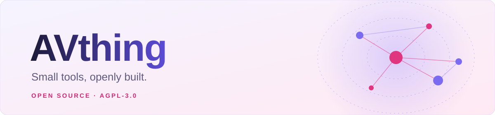

<picture>
  <source media="(prefers-color-scheme: dark)" srcset="banner-dark.svg">
  
</picture>

**瀏覽器擴充功能與小工具，一個一個做，全部開源。**

 

## 🧰 專案

<table>
  <tr>
    <td width="50%" valign="top">
      <h3>🔗 <a href="https://github.com/avthing/QuickLinker">QuickLinker</a></h3>
      偵測頁面上的編號，<b>一鍵跨站搜尋</b>並檢查各網站的連結是否可用。  
      <code>Chrome 擴充功能</code> · <code>JavaScript</code>
    </td>
    <td width="50%" valign="top">
      <h3>🖼️ <a href="https://github.com/avthing/PreviewImageSaver">PreviewImageSaver</a></h3>
      在影片頁按一下，把封面與<b>全部預覽圖</b>存到你指定的資料夾。  
      <code>瀏覽器擴充功能</code> · <code>JavaScript</code> · <code>MediaPipe</code>
    </td>
  </tr>
  <tr>
    <td width="50%" valign="top">
      <h3>💬 <a href="https://github.com/avthing/subtitlecat-ext">subtitlecat-ext</a></h3>
      依番號從 subtitlecat.com 抓<b>中文字幕</b>，自動掛到播放器上。  
      <code>瀏覽器擴充功能</code> · <code>JavaScript</code>
    </td>
    <td width="50%" valign="top">
      <h3>🕸️ costars-tool 即將公開</h3>
      <b>合作關聯圖</b>：2D／3D／4D 的離線互動視覺化，距離＝合作次數，垂直軸＝時間。  
      <code>WebGL</code> · <code>Python</code> · <code>Node.js</code>
    </td>
  </tr>
</table>

 

## 📜 授權

所有專案皆以 [GNU AGPL-3.0](LICENSE) 釋出。歡迎使用、修改與分享；散布衍生作品時，請保留版權聲明並以相同授權公開原始碼。

Copyright © 2026 AVthing

